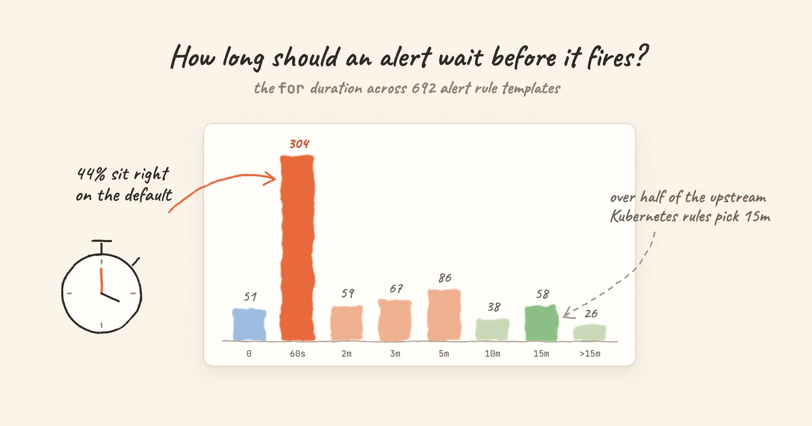

Every alert rule answers two questions: what counts as bad, and how long it has to stay bad. Most review effort goes into the first one, the expression and the threshold. The second is the `for` duration, and it often gets whatever value the tool filled in.

We wanted to know how often that happens, so we counted. Nightingale ships alert rule templates for 49 integrations. **692 rules, and 304 of them (44%) have a `for` duration of exactly 60 seconds**, which is the default in Nightingale's rule editor. This post walks through what the numbers show and what `for` value suits which kind of alert.

<!-- truncate -->

## What `for` does

An alert rule is evaluated on a schedule. When the expression first returns a series, the alert is *pending*. It becomes *firing* only once the same series has kept matching on every evaluation for at least the `for` duration. If the series disappears for even one evaluation, the clock starts over.

Three consequences follow:

- **Detection time is about `for` plus one evaluation interval.** A rule with `for: 5m` evaluated every minute fires five to six minutes after the problem starts.
- **A series that flaps never fires.** If the condition comes and goes faster than `for`, no alert is created, and no recovery either. That is the point of `for`, and also a risk.
- **The defaults differ by tool.** In Prometheus, leaving out `for` means 0, so the alert fires on the first evaluation that matches. In Nightingale's rule editor, a new rule starts at a 60-second `for` and a 60-second evaluation interval. The bundled templates set their own interval, almost always 15 or 30 seconds.

## How we counted

The data is the alert rule templates bundled with Nightingale's integrations: Kubernetes, Linux, MySQL, Redis, Elasticsearch and 44 more. They are published in the [alert rule library](/alert-rules) and on each integration page.

- 705 rules in total, **692 after removing exact duplicates** (same integration, same name, same expression).
- Some checks exist twice on purpose, once for Categraf metrics and once for a Prometheus exporter, because the metric names differ. We count those separately.
- These are **templates**, not production configs. They show what template authors chose. They say nothing about what users changed after importing them.
- Counted on 2026-11-01, after the two changes described in Finding 4.

## The distribution

| `for` | Rules | Share |
|---|---|---|
| 0 | 51 | 7.4% |
| 60s | 304 | 43.9% |
| 2m | 59 | 8.5% |
| 3m | 67 | 9.7% |
| 5m | 86 | 12.4% |
| 10m | 38 | 5.5% |
| 15m | 58 | 8.4% |
| Over 15m | 26 | 3.8% |

Three rules use 15s or 90s and are left out of the table.

## Finding 1: the default wins, unless someone chose deliberately

The 60-second spike is the obvious feature. We can't tell from the data whether 304 authors thought about it and picked 60s, or simply kept what the form offered. What we can see is a clear difference between where the rules came from:

- **86 rules** in the Kubernetes template keep the standard alert names from [kubernetes-mixin](https://github.com/kubernetes-monitoring/kubernetes-mixin) and the Prometheus monitoring mixins, the community rule sets behind most Kubernetes monitoring stacks. **46 of them use 15 minutes**, and only 2 use 60 seconds. The mixin authors set `for` alert by alert.
- Rules written for Categraf and for Prometheus exporters have a **median of 60 seconds**. Only 4 of the 352 use 15 minutes.

Neither is wrong as a whole. The point is that a default is a choice someone else made for you, before they knew what the rule would watch. With the templates' 15- or 30-second evaluation intervals, a 60-second `for` means "matched on two to four evaluations in a row". That is reasonable for CPU, memory and latency. It is too short for things that recover on their own, and too long for events that are over in seconds.

## Finding 2: `for: 0` is right for events, if the window is wide enough

51 rules fire on the first match (four of them are host heartbeat checks with no PromQL). Most of the rest watch something that has *already happened*, so waiting adds nothing:

- A counter went up: `increase(node_vmstat_oom_kill[1m]) > 0`. The OOM kill happened; it will not un-happen in five minutes.
- A deadline is close: `kubelet_certificate_manager_client_ttl_seconds < 604800`. Under seven days is under seven days.
- A process restarted: `mysql_global_status_uptime < 60`.

The restart check hides a trap. `uptime < 60` is only true for the first 60 seconds after a restart. Any `for` of 60 seconds or more means the alert can never fire, because uptime passes 60 before the duration is met. And the window has to fit several evaluations: copy `uptime < 60` into a rule evaluated every 60 seconds, and it gets one chance per restart, which scrape delay can easily push out of the window.

The templates get this right in different ways. The MySQL and MongoDB rules use `uptime < 60` with `for: 0`, and they evaluate every 15 seconds, so each restart gets about four chances. The Redis rules widen the window to `uptime_in_seconds < 600`. The Apache, EMQX and OpenLDAP rules use `uptime < 300` with `for: 60s`. **Make the window several evaluation intervals wide, keep `for` well under it, and keep both in mind if you change the evaluation interval.**

## Finding 3: some rules move the waiting into the expression

Of the 47 `for: 0` rules that have a PromQL expression, 22 wrap their metric in a range function, so the persistence check happens inside PromQL:

```promql
# GitLab's ServiceDown template, for: 0
avg_over_time(up[5m]) * 100 < 50
```

This is not the same as `up == 0` with `for: 5m`:

| | `up == 0` with `for: 5m` | `avg_over_time(up[5m]) < 0.5` with `for: 0` |
|---|---|---|
| Fires when | Every evaluation in the last 5 minutes saw the target down | The target was down for more than half of the last 5 minutes |
| One good scrape in the middle | Resets the clock | Barely moves the average |
| Good for | "Continuously broken" | "Mostly broken", for flapping targets |

Pick the one that matches what you mean. A target that answers one scrape in four is broken, and only the second form will say so.

## Finding 4: a few instant checks deserved a longer wait

Counting also turned up `for: 0` rules that compare a sampled value against a threshold with no window at all. Two of them we changed while writing this post:

- `elasticsearch_cluster_health_status{color="yellow"} == 1`. A cluster goes yellow on every rolling restart while replicas are reallocated. It now waits 10 minutes.
- `(node_nf_conntrack_entries / node_nf_conntrack_entries_limit) > 0.75`. A single busy scrape was enough to trigger it. It now waits 5 minutes, the same as the sibling rule at 80%.

The tables in this post already include both changes. The general rule: give sampled gauges a few evaluation intervals, or a range function as in Finding 3. Keep `for: 0` for the checks that really are binary: `mysql_up == 0`, a failed systemd unit, a replication thread that stopped.

## Finding 5: long waits are for slow problems

26 rules wait longer than 15 minutes. Most of them watch something that develops slowly:

- The node filesystem predictions from kubernetes-mixin use one hour. A `predict_linear` forecast swings a lot on short windows; an hour of consistent prediction means the trend is real.
- Prometheus TSDB compaction failures wait four hours. One failed compaction is noise; a run of them is a problem.
- A kernel version mismatch across nodes waits six hours. It is a hygiene check, not an incident.
- The slow windows of the Kubernetes API error budget burn alerts wait one and three hours. They are designed to catch slow, steady burns.

Long `for` values pair naturally with a lower severity. Nobody should be paged at 3 a.m. for something that took six hours to become true.

## The severity side

The same templates carry a severity. Nightingale has three levels: S1 (critical), S2 (warning) and S3 (info).

| Severity | Rules | Share |
|---|---|---|
| S2 / warning | 490 | 71% |
| S1 / critical | 137 | 20% |
| S3 / info | 60 | 9% |

Five rules have no rule-level severity. When seven rules in ten share a level, the level stops helping anyone route or prioritize. A workable split:

- **S1**: someone must act now. Users are affected or data is about to be lost.
- **S2**: someone should look today. Capacity trends, single replicas down with redundancy left.
- **S3**: record it, don't notify. Useful context during an incident.

24 templates put several severities on one rule. The Linux CPU rule, for example, uses `cpu_usage_active > 75` as S3, `> 85` as S2 and `> 95` as S1. One rule with three tiers keeps the thresholds side by side, which is easier to review than three separate rules that drift apart.

## Rules of thumb

| What the rule watches | `for` | Example |
|---|---|---|
| Something that already happened | 0 | OOM kill counter increased, certificate under 7 days |
| A binary up/down state | 0 to 1 evaluation interval | `mysql_up == 0` |
| A sampled gauge: CPU, memory, latency, error rate | 2–3 evaluation intervals | CPU over 90% |
| Something that often recovers by itself | Longer than its normal recovery time | A queue that usually drains in 5 minutes: 10m |
| A slow trend | 30m to several hours, lower severity | Disk full within 24 hours |

`for` only controls when an alert starts. If an alert fires and recovers over and over, `for` is not the fix. Use a recovery delay instead: `keep_firing_for` in Prometheus, or the recover duration in Nightingale. See [Evaluation interval and recovery](/docs/alerting/evaluation).

## Where to look next

Every rule in the [alert rule library](/alert-rules) shows its severity and its `for` value ("Fires after"), and links to a runbook. You can download a whole rule set as a Prometheus rules file, or import it into Nightingale from the matching [integration](/integrations).
