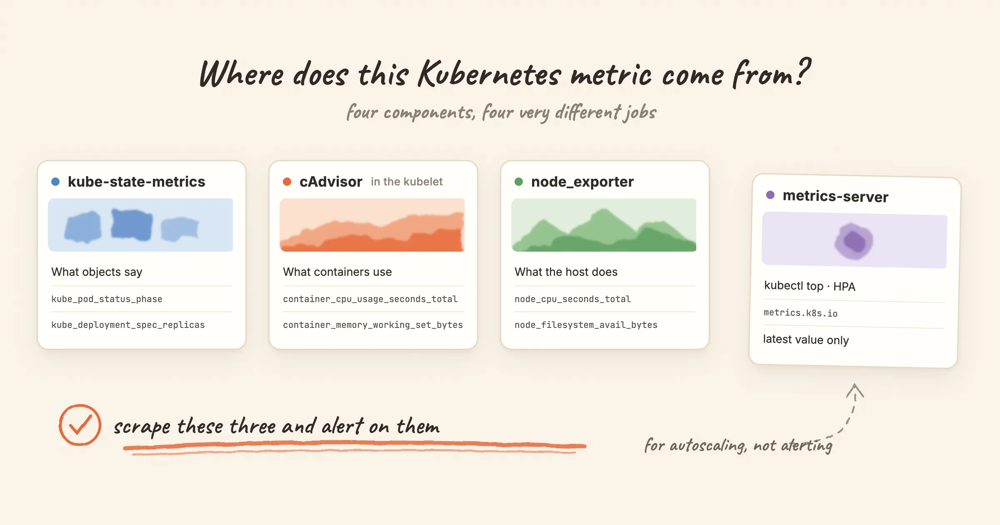

**kube-state-metrics exposes Kubernetes object state for monitoring; metrics-server supplies recent CPU and memory usage through the Metrics API for autoscaling and `kubectl top`.** A Deployment's missing replicas and a Pod's current CPU usage are different questions. A cluster that needs both autoscaling and object-state alerts will commonly use both components.

For a full monitoring setup, add the other two sources: cAdvisor for container resource usage and node_exporter for the host underneath. This post explains which component answers each question, where to scrape it, and the metric renames that can break an otherwise valid alert query.

<!-- truncate -->

## The short answer

| Component | Measures | Where it gets the data | Metric prefix | Use it for |
|---|---|---|---|---|
| **kube-state-metrics** | The state of Kubernetes objects: desired vs actual replicas, pod phase, container restarts, resource requests and limits | Watches the API server | `kube_` | Alerting and dashboards |
| **cAdvisor** | What each container actually uses: CPU, memory, throttling, filesystem, network | Built into the kubelet, served at `/metrics/cadvisor` | `container_` | Alerting and dashboards |
| **node_exporter** | The machine underneath: CPU modes, memory, disks, filesystems, network interfaces | A DaemonSet reading `/proc` and `/sys` on each node | `node_` | Alerting and dashboards |
| **metrics-server** | A CPU and memory snapshot for each pod and node | Scrapes the kubelet's `/metrics/resource` | none; it serves the Metrics API (`metrics.k8s.io`) | `kubectl top`, the Horizontal and Vertical Pod Autoscalers |

You will also meet two more sources. The kubelet's own `/metrics` endpoint provides things like `kubelet_volume_stats_available_bytes`, which tells you how full a PersistentVolume is. The API server exposes `apiserver_*` metrics about itself. Neither belongs to the four above, and alert rules use both.

## Do you need kube-state-metrics, metrics-server or both?

Choose by the consumer of the data:

- **HPA based on Pod CPU or memory, or `kubectl top`:** metrics-server provides the Resource Metrics API for this path. kube-state-metrics does not replace it. An HPA based on custom or external metrics can use a different adapter.
- **Alerts about desired state:** use kube-state-metrics for unavailable Deployment replicas, failed Jobs, restart counts and Pod waiting reasons. Scrape its `/metrics` endpoint into Prometheus or a compatible store.
- **Container CPU and memory dashboards or alerts:** scrape the kubelet's container resource metrics, commonly `/metrics/cadvisor`, into the monitoring store. kube-state-metrics supplies requests and limits to compare the usage with.
- **Host disk, network and operating-system checks:** use node_exporter on each node.

In a cluster that uses CPU-based autoscaling and Prometheus alerting, these are complementary data paths. You do not have to route metrics-server through Prometheus, or install kube-state-metrics just to make `kubectl top` work. The [kube-state-metrics README](https://github.com/kubernetes/kube-state-metrics/blob/main/README.md) and [Kubernetes resource metrics pipeline](https://kubernetes.io/docs/tasks/debug/debug-cluster/resource-metrics-pipeline/) explain the distinction.

## kube-state-metrics: what the API server believes

kube-state-metrics listens to the API server and turns objects into metrics. Its README calls this "the health of the various objects inside" the cluster, as opposed to the health of the cluster components themselves. It exposes the values as the API returns them. It does not apply the heuristics `kubectl` uses, which is why its numbers sometimes differ from what `kubectl get` prints.

That makes it the right source for questions about intent:

- Does the Deployment have the replicas it asked for? `kube_deployment_spec_replicas` vs `kube_deployment_status_replicas_available`.
- Is a container stuck in `CrashLoopBackOff`? `kube_pod_container_status_waiting_reason`.
- Why did the last run end? `kube_pod_container_status_last_terminated_reason`, where `reason="OOMKilled"` is the one you usually want.
- Is a node `NotReady`? `kube_node_status_condition`.

It tells you nothing about usage. A pod at 100% of its CPU limit and an idle pod look the same to kube-state-metrics. For usage you need cAdvisor.

**The rename that breaks old queries.** kube-state-metrics 2.0 removed the per-resource metrics such as `kube_pod_container_resource_limits_cpu_cores` and `kube_pod_container_resource_requests_memory_bytes`. Their replacements are `kube_pod_container_resource_limits` and `kube_pod_container_resource_requests`, with `resource` and `unit` labels:

```promql
# kube-state-metrics 1.x (removed in 2.0)
kube_pod_container_resource_limits_cpu_cores

# kube-state-metrics 2.x
kube_pod_container_resource_limits{resource="cpu", unit="core"}
```

A query that uses the old name does not fail. It returns an empty result, and an alert rule built on it never fires. We found exactly this in our own Kubernetes template while writing this post: the [container CPU rule](/alert-rules/kubernetes#container-cpu-usage-exceeds-80) still used the 1.x metric name and the old `pod_name` label. It now uses the current names.

## cAdvisor: what containers actually use

cAdvisor is compiled into the kubelet, so there is nothing extra to deploy. Prometheus scrapes it from each node at `/metrics/cadvisor`. These are the metrics you reach for when a pod is slow or keeps getting killed:

- `container_cpu_usage_seconds_total`: CPU time consumed. Take a `rate()` to get cores in use.
- `container_memory_working_set_bytes`: the container's working-set estimate. It is not the same as RSS or a definitive measurement of unreclaimable memory; active file cache can contribute to it. Use the termination reason as well when diagnosing an OOM kill.
- `container_cpu_cfs_throttled_periods_total` and `container_cpu_cfs_periods_total`: how often the container hit its CPU limit and was paused. The [CPUThrottlingHigh](/alert-rules/kubernetes#cputhrottlinghigh) rule is the ratio of the two.

Two things trip people up:

1. **Extra series.** cAdvisor also reports cgroups that are not your application container: a pod-level series with `container=""` and, on older Docker-based nodes, the pause container as `container="POD"`. Summing without a filter counts the same memory twice. Add `container!=""` (and `container!="POD"` on old nodes) when you aggregate.
2. **Label names changed.** Older Kubernetes examples use `pod_name` and `container_name`. Current kubelet metrics use `pod` and `container`. Grouping by a missing `pod_name` label loses the intended Pod identity; joins that expect the old labels can return no matches or combine the wrong series. Check the labels on the data you actually scrape.

Usage becomes useful when you compare it with a limit, and the limit lives in kube-state-metrics. Both sides share the `namespace`, `pod` and `container` labels, so the join is direct:

```promql
max by (cluster, namespace, pod, container) (
  container_memory_working_set_bytes{container!="", container!="POD"}
)
/
(
  max by (cluster, namespace, pod, container) (
    kube_pod_container_resource_limits{resource="memory", unit="byte"}
  ) > 0
)
> 0.9
```

Both sides must identify the same container. Preserve a common `cluster` label when querying multiple clusters; adapt the grouping labels to your setup. The positive-limit filter excludes containers without a positive memory limit, and `max` avoids adding identical duplicate scrape series together. This is a threshold against configured limits, not proof that the workload is about to be OOM-killed. The [cAdvisor metric reference](https://github.com/google/cadvisor/blob/master/docs/storage/prometheus.md) describes the usage metrics.

## node_exporter: the machine underneath

On Kubernetes, node_exporter commonly runs as a DaemonSet with access to the host's `/proc` and `/sys`. It knows nothing about pods. It reports the operating system: `node_cpu_seconds_total` by mode, `node_memory_MemAvailable_bytes`, `node_filesystem_avail_bytes`, disk I/O and network errors.

Use it for the questions Kubernetes does not answer. Is the node's root filesystem filling up? Is the clock drifting? Is a NIC dropping packets? Is the kernel OOM killer firing (`node_vmstat_oom_kill`)? Node-level memory includes page cache and every process on the host, so it will not add up to the sum of your containers. That is expected.

The [Linux rule set](/alert-rules/linux) covers the common host checks, including disk-fill prediction with `predict_linear`.

## metrics-server: the autoscaling data path

metrics-server collects CPU and memory every 15 seconds from each kubelet's `/metrics/resource` endpoint and serves them through the Metrics API. The Horizontal Pod Autoscaler reads it, the Vertical Pod Autoscaler reads it, and `kubectl top` reads it.

It keeps recent resource values in memory rather than a queryable monitoring history. Its own `/metrics` endpoint exposes self-monitoring, not a replacement Prometheus feed for every Pod's CPU and memory. The [project's README](https://github.com/kubernetes-sigs/metrics-server/blob/master/README.md) says metrics-server is intended for autoscaling rather than forwarding metrics to monitoring solutions. If you want resource data in a monitoring store, scrape the appropriate kubelet endpoints directly.

So when `kubectl top` and a dashboard disagree, check the sampling window, aggregation, endpoint and metric definition before assuming either value is wrong. For the endpoint layout, see the [Kubernetes system metrics guide](https://kubernetes.io/docs/concepts/cluster-administration/system-metrics/).

## Can metrics-server replace Prometheus?

metrics-server serves the resource API used by autoscaling and `kubectl top`. Prometheus scrapes and stores time series for historical queries and rule evaluation. Installing one does not provide the other one's consumer APIs or operating model.

If you are choosing where the alert rules themselves should run, [Grafana Alerting vs Alertmanager](/blog/grafana-alerting-vs-alertmanager) compares evaluation and notification ownership. The metric sources in this article can remain the same whichever evaluation path you choose.

## Which component answers your question

| Question | Metric | Source |
|---|---|---|
| Is the pod restarting? | `kube_pod_container_status_restarts_total` | kube-state-metrics |
| Was it OOM-killed? | `kube_pod_container_status_last_terminated_reason{reason="OOMKilled"}` | kube-state-metrics |
| Is a container close to its memory limit? | `container_memory_working_set_bytes` ÷ `kube_pod_container_resource_limits{resource="memory"}` | cAdvisor + kube-state-metrics |
| Is it being CPU-throttled? | `container_cpu_cfs_throttled_periods_total` ÷ `container_cpu_cfs_periods_total` | cAdvisor |
| Does the Deployment have the replicas it wants? | `kube_deployment_status_replicas_available` vs `kube_deployment_spec_replicas` | kube-state-metrics |
| Is a node `NotReady`? | `kube_node_status_condition{condition="Ready"}` | kube-state-metrics |
| Is a node's disk filling up? | `node_filesystem_avail_bytes` | node_exporter |
| Is a PersistentVolume filling up? | `kubelet_volume_stats_available_bytes` | kubelet |
| How much CPU is the pod using right now? | `kubectl top pod` | metrics-server |

## Ready-made rules, sorted by source

Most of the standard Kubernetes alerts read kube-state-metrics. Each of these pages explains what the alert means, its common causes and the steps to fix it, and lists the metrics it uses:

- kube-state-metrics: [KubePodCrashLooping](/alert-rules/kubernetes/kubepodcrashlooping), [KubePodNotReady](/alert-rules/kubernetes/kubepodnotready), [KubeDeploymentReplicasMismatch](/alert-rules/kubernetes/kubedeploymentreplicasmismatch), [KubeNodeNotReady](/alert-rules/kubernetes/kubenodenotready), [KubeJobFailed](/alert-rules/kubernetes/kubejobfailed), [KubeHpaMaxedOut](/alert-rules/kubernetes/kubehpamaxedout)
- kubelet: [KubePersistentVolumeFillingUp](/alert-rules/kubernetes/kubepersistentvolumefillingup)
- cAdvisor: [CPUThrottlingHigh](/alert-rules/kubernetes#cputhrottlinghigh)
- API server: [KubeAPIErrorBudgetBurn](/alert-rules/kubernetes/kubeapierrorbudgetburn), [KubeClientCertificateExpiration](/alert-rules/kubernetes/kubeclientcertificateexpiration)

The full [Kubernetes rule set](/alert-rules/kubernetes) is available as a Prometheus rules file you can download and load with `rule_files`.

## With Nightingale

Nightingale does not replace any of these four components. It queries the store where their metrics already land, such as Prometheus or VictoriaMetrics, and runs alert rules against it. The [Kubernetes integration](/integrations/kubernetes) ships the rules above, each with its runbook attached, and you can [import them into a business group](/docs/data/integrations/import) in one step.
