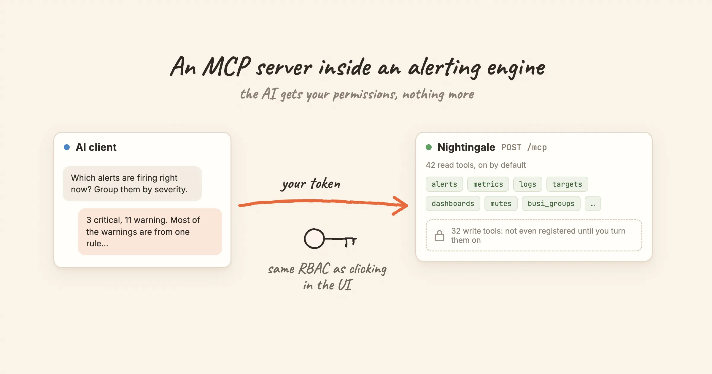

Since v9, the Nightingale process is also an MCP server. Claude Code, Cursor or any other MCP client can connect to `/mcp` and ask which alerts are firing, which rules are noisiest, or what a metric did over the last hour.

The tool list was the easy part. The hard questions were about trust. Whose permissions does the AI client have? What can it change? How do you find out afterwards what it did? This post walks through the six decisions we made, and one caveat we haven't solved.

<!-- truncate -->

What this is not: an autonomous agent that resolves incidents on its own. It is a way for a model to read, and with explicit opt-in to change, an alerting system with the same permissions as the person who connected it.

## 1. No separate server: the endpoint lives in the process

There is nothing extra to deploy. `POST /mcp` is served by the same `n9e` process that serves the UI and the API, and it is on by default.

It uses MCP's Streamable HTTP transport in **stateless** mode. Every POST is self-contained. The server returns an `Mcp-Session-Id` on initialize but never validates it, and `GET /mcp` returns 405 because there is no standalone event stream. The practical benefit: several Nightingale instances behind a load balancer need no sticky sessions. Any instance can answer any request.

## 2. A tool call is an internal API call

When a client calls `list_alert_rules`, the MCP server does not read the database. It dispatches the call, in-process, onto Nightingale's own HTTP route (`/api/n9e/busi-group/{gid}/alert-rules`), carrying the caller's token through the full middleware chain: authenticate, resolve the user, check the permission point, check the business group.

So the answer to "can the AI get around RBAC?" is structural: no. It walks the same path as a click in the UI. There is no separate permission model for AI to configure, audit and keep in sync.

The consequence is that **a client has exactly the permissions of its token's owner**. To limit what the AI can see, you give it a limited account: a dedicated user with the `Guest` or `Standard` role, in a team that can read only the business groups you choose. `list_busi_groups` returns only groups that user can reach, so the model can only ever pick from that set. Do not give the AI account the `Admin` role. Admin bypasses the business-group layer.

OAuth tokens get one more restriction. A token issued through OAuth works on `/mcp` and `/a2a` only; the rest of the API rejects it.

## 3. Write tools are not registered, not just refused

There are 74 tools. 42 read and 32 write. By default only the 42 read tools exist. The write tools sit in a separate registration list that is skipped unless you set:

```toml
[HTTP.A2A]
MCPEnableWriteTools = true
```

We chose "not registered" over "registered and refused" on purpose. A model plans with the tools it can see. If write tools appear in `tools/list` and fail at call time, the model keeps trying them, or tries to work around the error. If they are absent, the model never considers them.

This gate sits outside RBAC. Even if a client is handed root's token by mistake, under the default config it cannot change anything. Every tool also carries MCP's `readOnlyHint` annotation for clients that use it, and it always agrees with the registration list.

## 4. No delete tools at all

None of the 74 tools deletes anything. "Write" means create and update. Deleting a rule, a user or a business group is not reachable through MCP.

This changes the worst case from "gone" to "changed wrongly", which is easier to notice and to fix. It does not make write tools harmless. Some of them are among the most powerful operations in the product:

| Tool | Why it is dangerous |
|---|---|
| `reset_user_password` | Resets any user's password |
| `create_user`, `update_user_profile` | Assign roles as a side effect, which is privilege escalation |
| `bind_role_operations` | Replaces a role's whole permission set; a short payload silently removes permissions |
| `create_notify_channel`, `update_notify_channel` | A webhook channel sends alert content to any address it is given |
| `upsert_datasource` | Stores data source credentials and probes the address it is given |
| `set_dashboard_public` | Makes a dashboard readable without login |
| `toggle_alert_rules`, `set_datasource_status`, `create_mute` | Create blind spots: rules disabled, a data source off, alerts silenced |

## 5. Toolsets are an allowlist, and typos don't fall back

The 74 tools are grouped into 13 toolsets: `alerts`, `targets`, `datasource`, `mutes`, `busi_groups`, `notify_rules`, `alert_subscribes`, `event_pipelines`, `users`, `metrics`, `logs`, `dashboards` and `roles`. An empty list exposes all of them; a list exposes only those named:

```toml
[HTTP.A2A]
MCPToolsets = ["alerts", "busi_groups", "targets", "metrics"]
```

A misspelled name is dropped with a warning in the log. It does **not** fall back to "everything". A list made entirely of typos exposes zero tools, not 74. Failing closed is less convenient and much safer.

Work backwards from what you want the AI to do:

| Use | Toolsets |
|---|---|
| On-call triage: what is firing, which rule, who owns it | `alerts`, `busi_groups`, `targets` |
| Plus "explain this spike" | add `metrics` |
| Noise review: noisiest rules, mutes, subscriptions | add `mutes`, `alert_subscribes` |
| Letting the AI change configuration | turn on writes, and remove `users` and `roles` first |

## 6. Every call is attributable

Two trails answer "who changed this, and was it the AI?":

- **The object itself.** A rule, mute or dashboard changed over MCP records the token owner's username in `update_by`, exactly as if they had edited it in the UI.
- **The request log.** Every `/mcp` request writes a start line with the full request body (tool name and arguments) and a done line with the user and status code, joined by a `trace_id`:

  ```bash
  grep '"method":"tools/call"' n9e.log | grep -oE '"name":"[a-z_]+"' | sort | uniq -c | sort -rn
  ```

  Oversized bodies are truncated, and the log line says so.

A dedicated account per client makes both trails useful. If every client shares one token, `update_by` tells you nothing.

## The caveat: `query_logs` and SQL data sources

One read-only tool deserves care. `query_logs` in the `logs` toolset passes the query body to Nightingale's log query endpoint, which dispatches on the data source type. If you have SQL data sources registered (MySQL, PostgreSQL, ClickHouse, Doris or TDengine), the SQL runs as written.

There is a read-only check on that path. It is a keyword blocklist that rejects statements containing `INSERT`, `UPDATE`, `DELETE`, `DROP`, `ALTER`, `CREATE`, `TRUNCATE`, `REPLACE`, `GRANT` or `REVOKE`. That stops the obvious cases. It is not a SQL parser, so treat it as a second line of defence rather than a guarantee. If you have SQL data sources, leave `logs` out of `MCPToolsets`, or give the AI account a role that cannot reach those data sources. Registering them with read-only database credentials is a sensible extra layer.

## MCP or the built-in assistant?

Nightingale also has a built-in assistant in the UI. For configuration changes it is the safer of the two: its update operations are two-phase. The first call computes the change and shows a confirmation card, and nothing is written until a person confirms. MCP has no such step. A write tool writes on its first call.

So a reasonable split is: use an MCP client for reading and triage, where its own model and tools shine, and use the built-in assistant when something needs to change.

## Try it

Create a token for a dedicated, least-privileged user under **Profile → Token management**, then add Nightingale to your MCP client:

```json title="~/.claude.json"
{
  "mcpServers": {
    "nightingale": {
      "type": "http",
      "url": "http://127.0.0.1:17000/mcp",
      "headers": { "X-User-Token": "<token of the AI account>" }
    }
  }
}
```

Then ask something you can check: *"Which alerts are firing right now? Group them by severity."* or *"List every business group I can see."* The second one is also a quick test that the account is scoped the way you intended.

More detail is in the docs: [Enable the MCP endpoint](/docs/ai/mcp-endpoint), [Permission inheritance and RBAC](/docs/ai/permissions), [Read and write toolsets](/docs/ai/toolsets) and [Enable write tools safely](/docs/ai/write-tools).
