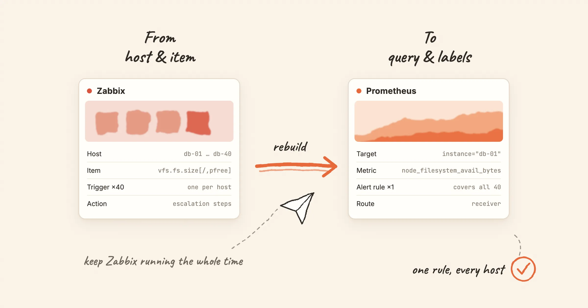

Moving from Zabbix to Prometheus is not a data migration. There is no export file that turns into rule files, and no tool that converts triggers into PromQL. The two systems model monitoring differently. Most of the work is translating concepts, then rebuilding a smaller set of rules on top of them.

This post maps each Zabbix concept to its Prometheus counterpart, lists the parts that have no equivalent, and suggests an order of work that keeps Zabbix running until the end.

<!-- truncate -->

## The difference that explains everything else

**Zabbix is host-centric.** You create a host, attach templates, and the templates define items (what to collect) and triggers (when to alert) for that host. 40 database servers with one template give you 40 copies of each trigger.

**Prometheus is query-centric.** Exporters expose metrics, Prometheus scrapes them, and an alert rule is a query. A rule matches every series the query returns. One rule covers all 40 servers, and the 41st server is covered as soon as it is scraped.

Most of the translation follows from this. You rarely port triggers one by one; you merge them.

## Concept map

### Collection and storage

| Zabbix | Prometheus | Notes |
|---|---|---|
| Zabbix server and database | Prometheus server and its local TSDB | Local retention is short by default (15 days). Long-term storage is a separate component |
| Zabbix agent | Exporters: node_exporter for hosts, mysqld_exporter for MySQL and so on | Prometheus *pulls* over HTTP; the agent's active checks *push*. Targets must be reachable from Prometheus |
| Zabbix proxy | A Prometheus server per site, or Prometheus in agent mode with `remote_write` | Agent mode scrapes and forwards without evaluating rules locally |
| Item | A metric name plus labels | Which metrics exist is decided by the exporter, not by the monitoring server |
| Item key `vfs.fs.size[/,pfree]` | `node_filesystem_avail_bytes{mountpoint="/"}` ÷ `node_filesystem_size_bytes{mountpoint="/"}` | Percentages are usually computed in the query |
| Calculated item | Recording rule | |
| History and trends | Raw samples; downsampling only in long-term stores such as Thanos | There is no built-in hourly min/avg/max like Zabbix trends |
| Text and log items | None | Prometheus stores numbers only. Logs go to Loki, Elasticsearch or similar |

### Hosts, templates and discovery

| Zabbix | Prometheus | Notes |
|---|---|---|
| Host | A scrape target, identified by the `instance` label | |
| Host group | Labels such as `team` or `env`, added through relabeling | Groups become labels you can filter on |
| Template | An exporter, a rule file and a dashboard | The community equivalent of a template collection is a monitoring mixin |
| Low-level discovery (LLD) | Service discovery for targets; labels for things on a target | New filesystems or interfaces appear as new series automatically. No discovery rule needed |
| User macros `{$THRESHOLD}` | Hard-coded thresholds, or a threshold metric joined in the query | Per-host overrides need a pattern, see below |

### Triggers and alerting

| Zabbix | Prometheus | Notes |
|---|---|---|
| Trigger | Alerting rule: a PromQL `expr` plus `for` | One rule, many series |
| Trigger severity (six levels) | A `severity` label | A convention, not a built-in. Most teams use three: critical, warning, info |
| Recovery expression, hysteresis | No direct equivalent | `keep_firing_for` delays recovery; true hysteresis needs a query trick |
| `nodata()` | `absent()`, `absent_over_time()`, or `up == 0` | `absent()` only works for series you name explicitly |
| Trigger dependencies | Alertmanager `inhibit_rules` | Inhibition mutes target alerts while a source alert fires, matched on labels |
| Event correlation | None in Prometheus or Alertmanager | |

### Notification

| Zabbix | Prometheus | Notes |
|---|---|---|
| Action and operations | Alertmanager routes and receivers | Routing matches on labels |
| Media type | Receiver integration: email, Slack, webhook and others | |
| Escalation steps | Not built in | Alertmanager repeats notifications (`repeat_interval`) but has no escalation chain. That is an on-call tool's job |
| Maintenance period | Silences, plus `mute_time_intervals` for recurring windows | Silences are ad hoc; time intervals cover the weekly window |
| Acknowledgement | None in Alertmanager | Usually handled in the on-call or chat tool |

## The parts with no equivalent

Plan for these before you start. They are where migrations stall.

1. **Escalations.** Zabbix can notify the on-call engineer, then the team lead after 30 minutes, then the manager. Alertmanager cannot. If you rely on escalation, you need an on-call tool behind Alertmanager.
2. **Per-host thresholds.** In Zabbix you override `{$DISK_PFREE_MIN}` on one host. In Prometheus a threshold is part of the query. The common workaround is a small metric that carries thresholds, joined in the rule:

   ```promql
   (node_filesystem_avail_bytes / node_filesystem_size_bytes) * 100
     < on(instance) group_left()
   disk_free_threshold_percent
   ```

   Or keep a default rule and split the exceptions out by label: `disk_profile="large"` gets its own rule.
3. **SNMP traps.** The SNMP exporter polls; it does not receive traps. Traps need a separate receiver that turns them into metrics or logs.
4. **Text and log items.** If Zabbix watches log files or string values, those move to a log system, not Prometheus.
5. **Trigger dependencies, partly.** `inhibit_rules` cover the common case of "switch down mutes everything behind it". They need a label that links the two alerts, such as a shared `site` or `rack`. Zabbix's dependency tree has no labels to rely on, so you add them first.

## An order that keeps Zabbix running

Zabbix stays up and keeps paging people until the very last step. Each step can be checked on its own.

1. **Deploy exporters next to the Zabbix agents.** Start with one group of hosts. Leave the agents installed. *Check*: the targets are `up` in Prometheus.
2. **Pick the storage you will keep.** A single Prometheus for a start; a pair and a long-term store if you need HA or longer retention. Decide now, because changing stores later is a project of its own.
3. **Import existing rule sets instead of porting templates.** The community rules for node_exporter, MySQL, Redis, Kubernetes and others cover most of what stock Zabbix templates do. Our [alert rule library](/alert-rules) has them as downloadable rule files, each with a runbook.
4. **Port the custom triggers, merged.** List your custom triggers, group them by item and threshold, and write one rule per group. Use labels for the exceptions.
5. **Send Prometheus alerts somewhere nobody is paged.** A dedicated channel or mailbox. Compare it with Zabbix every day: fired only in Zabbix (missed rule or metric), fired only in Prometheus (threshold typo, or a Zabbix dependency or maintenance window you forgot), fired in both at different severity.
6. **Move notification one channel at a time.** Chat first, then email, then phone. Disable the matching Zabbix action as each channel moves, but keep Zabbix evaluating so the daily comparison continues.
7. **Stop Zabbix last.** After a week with no differences, stop the agents. Keep the database read-only for as long as you need the history. History does not migrate.

## Zabbix or Prometheus at all?

Not every Zabbix setup should move. Zabbix suits fleets of long-lived hosts and network devices, teams that want everything configured in one UI, and environments that need agents to push through firewalls. Prometheus suits environments where targets come and go (containers, autoscaling), where configuration lives in Git, and where software already exposes `/metrics`. Many organisations run both for years: Zabbix for network gear and legacy hosts, Prometheus for Kubernetes and new services.

## With Nightingale

[Nightingale](/docs/migration/from-zabbix) sits on top of Prometheus or VictoriaMetrics as the alerting layer. It manages rules in a UI with business groups and permissions, and handles notification, muting and subscriptions, so step 6 does not require learning Alertmanager's routing tree. It does **not** import Zabbix templates or triggers; the rebuild described above still applies.

Two Nightingale pages go deeper:

- [From Zabbix](/docs/migration/from-zabbix): every Zabbix object mapped to a Nightingale one, including the ones with no equivalent.
- [Coexistence and rollback plan](/docs/migration/coexistence): the daily comparison and channel-by-channel cutover in detail, with a rollback for each stage.

If you are still choosing, see [Nightingale vs Zabbix](/comparisons/zabbix).
