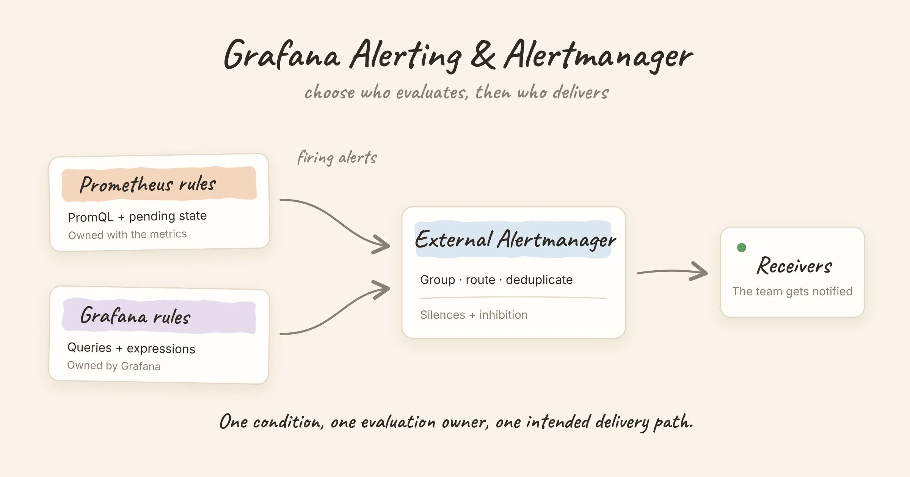

**Choose Prometheus with Alertmanager when your rules belong with your metrics and are maintained as code. Choose Grafana-managed alerting when you need Grafana to evaluate queries across supported data sources and manage conditions through its UI or provisioning tools.** You can also keep Prometheus rules, add Grafana-managed rules for other data, and use the same external Alertmanager for notification delivery.

The important decision is where a rule runs and who owns its notifications. Here is how to make those choices without evaluating the same condition twice.

<!-- truncate -->

## What you are comparing

Prometheus evaluates PromQL alerting rules. When an expression produces a matching label set, Prometheus tracks that alert's state and, once its pending period has elapsed, sends a firing alert downstream. **Alertmanager handles the delivery side:** deduplication, grouping, routing, silences and inhibition. It does not query your metrics or evaluate the PromQL threshold. See the official [alerting rules](https://prometheus.io/docs/prometheus/latest/configuration/alerting_rules/) and [Alertmanager overview](https://prometheus.io/docs/alerting/latest/alertmanager/).

Grafana Alerting includes a rule evaluator and notification management. With a **Grafana-managed rule**, Grafana executes the queries, evaluates the condition and produces alert instances. Its notification configuration then decides where those alerts go. The data source must support backend alerting; a query that works on a dashboard is not sufficient proof. [Grafana documents that requirement here](https://grafana.com/docs/grafana/latest/alerting/alerting-rules/create-grafana-managed-rule/).

Two common paths therefore look like this:

```text
Prometheus evaluates rules → Prometheus Alertmanager → receivers

Grafana evaluates rules    → Grafana's Alertmanager   → contact points
```

The storage system can be the same Prometheus in both cases. Moving evaluation to Grafana does not require moving the stored metrics.

## Grafana Alerting vs Prometheus + Alertmanager

| Decision | Prometheus + Alertmanager | Grafana-managed alerting |
|---|---|---|
| Who evaluates the condition? | Prometheus | Grafana |
| What can the rule query? | Data accessible through PromQL | Supported backend data sources; rules can combine queries and expressions |
| Where is the rule maintained? | Prometheus rule files; commonly generated or deployed through GitOps | Grafana UI, provisioning files, Terraform or APIs |
| Who handles delivery? | External Alertmanager | Grafana's notification system, or a configured external Alertmanager |
| How are destinations selected? | Alertmanager routes and receivers | Contact points and notification policies, or the external Alertmanager's configuration |
| Can dashboards stay in Grafana? | Yes | Yes |
| Who diagnoses an evaluation failure? | The team operating Prometheus and its rule configuration | The team operating Grafana alert evaluation and its data source access |

Both designs can be managed as code. Grafana's UI is a useful option, and its [provisioning tools](https://grafana.com/docs/grafana/latest/alerting/set-up/provision-alerting-resources/) also support reviewable configuration. Decide who is allowed to edit provisioned resources and how those edits are deployed before treating either UI as the source of truth.

## Three setups that are easy to confuse

### 1. Grafana displays alerts that another system evaluates

With a **data source-managed rule**, a compatible external system stores and evaluates the rule. Grafana provides an interface to it. Grafana's documentation describes this separately from [Grafana-managed rules](https://grafana.com/docs/grafana/latest/alerting/alerting-rules/create-data-source-managed-rule/).

Check which API the data source exposes. A Mimir or Loki ruler, a plain Prometheus server and an Alertmanager do different jobs. Adding an Alertmanager data source does not give Grafana a general-purpose API for editing Prometheus rule files.

### 2. Grafana evaluates rules and uses its own notifications

Grafana owns both the evaluation and the delivery configuration. This fits a team that already operates Grafana, needs conditions over multiple supported sources, and wants one place to maintain those rules.

For each data source, verify the evaluator's credentials and network access. A dashboard viewed by a logged-in person and a background alert evaluation can have different access conditions.

### 3. Grafana evaluates rules and sends them to an external Alertmanager

This is a useful coexistence model:

```text
Prometheus rules ─┐
                 ├→ external Alertmanager → existing receivers
Grafana rules ────┘
```

It lets a team keep its established routes and receivers while adding Grafana-managed evaluation. Grafana documents two ways to configure this: [forward all Grafana-managed alerts to an enabled Alertmanager, or use an Alertmanager contact point for selected alerts](https://grafana.com/docs/grafana/latest/alerting/set-up/configure-alertmanager/). Adding the data source alone does not enable forwarding.

Keep the route labels consistent. For example, both evaluators might attach `team="payments"` and `env="prod"`, so an existing payments route can match either source. The alert names should still describe the conditions distinctly.

## A small example: who detects the outage?

Here is a Prometheus rule that checks whether a scraped target has been unreachable for five minutes:

```yaml
groups:
  - name: service-availability
    rules:
      - alert: ServiceTargetDown
        expr: up{job="checkout"} == 0
        for: 5m
        labels:
          severity: warning
          team: payments
        annotations:
          summary: "Checkout target is unreachable"
```

Prometheus evaluates `up`, owns the five-minute pending state and sends the alert with the `team` label. Alertmanager can then route it to the payments receiver.

If you recreate the condition as a Grafana-managed rule, Grafana becomes a second evaluator. That may be appropriate during a controlled comparison, but leaving both enabled creates two independent alert identities. Sharing a destination does not guarantee they will deduplicate.

Also distinguish **zero** from **missing**. This expression matches a target whose `up` value is zero. It does not match a target that has disappeared from discovery and no longer has a current series. Test that case separately. Grafana-managed rules also have explicit [No Data and Error handling](https://grafana.com/docs/grafana/latest/alerting/fundamentals/alert-rule-evaluation/nodata-and-error-states/), which should be reviewed when translating a rule.

## Can Grafana edit Alertmanager routes?

The answer depends on the Alertmanager implementation. For a **Prometheus Alertmanager**, Grafana can manage silences, but contact points, notification policies and templates are read-only in that integration: its HTTP API does not support updating those resources. Edit and deploy the external configuration through the system that owns it. [Grafana calls out this limitation](https://grafana.com/docs/grafana/latest/alerting/set-up/configure-alertmanager/).

This matters when the original requirement is simply “give us a UI.” Viewing an alert, adding a silence, editing a routing tree and authoring a detection rule are four separate capabilities. Check which one your team needs before changing the architecture.

## How to choose

- **Keep Prometheus evaluation** when the rules already live alongside instrumentation, changes go through code review, and PromQL covers the detection requirements. Use Grafana for dashboards and Alertmanager for delivery.
- **Choose Grafana-managed evaluation** when a team needs its query and expression workflow over supported data sources, and is prepared to operate Grafana as an alerting dependency.
- **Use both with an external Alertmanager** when evaluation belongs in different systems but notification ownership should remain centralized. Document which system evaluates each condition.

Start a migration with one non-critical rule. Compare its labels, firing time, recovery behavior and destination against the existing rule. Include an empty result and a failed query in the check. Then disable the old evaluator for that condition and verify that only the intended notification path remains.

High availability needs a separate review. A working dashboard does not demonstrate that evaluation and delivery will survive a failed instance. Our [Prometheus HA guide](/blog/prometheus-high-availability) separates storage redundancy from alerting redundancy.

## Where Nightingale fits

Nightingale is another evaluation option when rules need business-group ownership and a UI across metrics, logs and SQL sources. Its [Grafana Alerting comparison](/comparisons/grafana-alerting) and [Prometheus + Alertmanager comparison](/comparisons/prometheus-alertmanager) describe the relevant trade-offs. For a database example, see [SQL query alerting on failed MySQL orders](/blog/sql-query-alerting-mysql).

For the wider choice, the [open-source alerting platform guide](/comparisons/open-source-alerting-platforms) separates rule evaluators, aggregation layers and on-call tools. Choose the layer that solves the operational requirement first.
