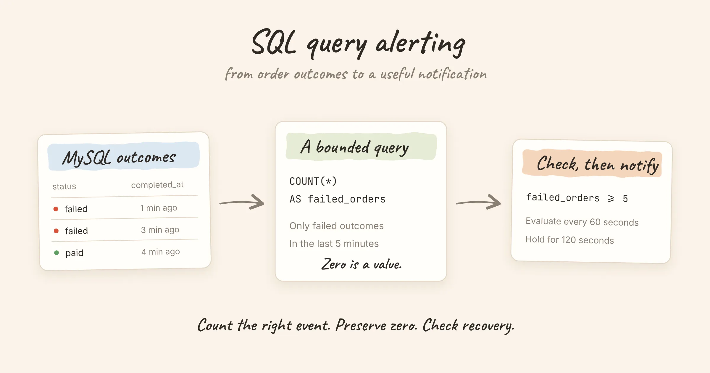

**SQL query alerting runs a query on a schedule and checks a numeric result against a condition.** It is useful when the number you care about already lives in a business database: failed orders, overdue jobs or a queue that has stopped draining.

This example counts failed orders in MySQL over the last five minutes and configures Nightingale to alert when that count stays at five or more for two minutes. It also handles the quiet case: no failed orders should produce a numeric zero that lets the alert recover.

<!-- truncate -->

## Decide what a failed order means

For this example, an application writes one final outcome per order into `order_outcomes`. The row is immutable after completion. `completed_at` is a UTC `DATETIME(6)`, and `status` is either `paid` or `failed`.

Here is a minimal schema for a scratch database:

```sql
CREATE TABLE order_outcomes (
    order_id BIGINT UNSIGNED NOT NULL PRIMARY KEY,
    channel VARCHAR(32) NOT NULL,
    status VARCHAR(16) NOT NULL,
    completed_at DATETIME(6) NOT NULL,
    INDEX alert_window (completed_at, status, channel)
);
```

If your application records individual payment attempts, counting rows would count attempts rather than orders. If it updates the same order from failed to paid after a retry, the result measures current state rather than historical failures. Choose the table and timestamp that match the question you want the alert to answer.

The explicit UTC convention matters. MySQL `DATETIME` does not perform the session time-zone conversion that `TIMESTAMP` does. This example therefore compares it with `UTC_TIMESTAMP(6)`. Adapt both sides together if your application uses a different convention. [MySQL explains the type behavior here](https://dev.mysql.com/doc/refman/8.4/en/datetime.html).

## Write a query that also represents zero

```sql
SELECT COUNT(*) AS failed_orders
FROM order_outcomes
WHERE status = 'failed'
  AND completed_at >= UTC_TIMESTAMP(6) - INTERVAL 5 MINUTE
  AND completed_at < UTC_TIMESTAMP(6);
```

The lower bound keeps the scan within the recent window. The upper bound excludes future-dated rows. MySQL's current-time functions are evaluated consistently within a statement, so the two boundaries describe one window. See the [date and time function reference](https://dev.mysql.com/doc/refman/8.4/en/date-and-time-functions.html).

Most importantly, `COUNT(*)` without `GROUP BY` returns one row even when nothing matches:

| failed_orders |
|---:|
| 0 |

That is a successful observation of zero failures. A query error or an absent result is a different condition. [MySQL documents the empty-input behavior of COUNT here](https://dev.mysql.com/doc/refman/8.4/en/aggregate-functions.html#function_count).

## Connect the database and map the result

In Nightingale, register a MySQL data source with an account that has `SELECT` access to the required table. Set its associated alerting engine cluster, connection limits and timeout. The [SQL database setup guide](/docs/data/sql-databases) covers those fields.

Create a MySQL alert rule, select that data source, and put the statement above in query **A**. Under **Auxiliary settings**, set:

| Setting | Value |
|---|---|
| Value field | `failed_orders` |
| Label field | Empty: this query returns only the numeric column |
| Trigger expression | `$A.failed_orders >= 5` |
| Execution frequency | `@every 60s` as a starting point |
| For duration | `120` seconds |
| Recovery configuration | Recover only when data exists and the trigger condition is not met |

The threshold and schedule are example settings, not recommended limits for every service. With a 60-second schedule and a 120-second pending period, detection requires several consecutive matching evaluations. It is not an exact timer starting at the fifth failed order. The [evaluation and recovery guide](/docs/alerting/evaluation) explains the timing.

Use **Preview** on the rule's query card to check the value. In Nightingale's open-source edition, this MySQL workflow is in the rule form rather than the metrics explorer. Then use **Test fire** to check the expression and inspect [evaluation records](/docs/alerting/execution-records) after saving.

Write the time predicate into the SQL itself. Nightingale's MySQL alert query does not supply Grafana-style `$__timeFilter` macros with an evaluation time range. Changing a preview time picker is not a substitute for the two bounds in this statement. The complete field mapping is in [SQL-backed rules](/docs/alerting/sql-rules).

## Add channels without losing recovery rows

Suppose the payments team wants separate alerts for `card` and `bank_transfer`. A simple `GROUP BY channel` over failed rows stops returning a channel as soon as its failure count reaches zero. Under a data-required recovery policy, that missing row does not prove the alert has recovered.

Return the expected channel set and join the failures onto it:

```sql
SELECT channels.channel,
       COUNT(outcomes.order_id) AS failed_orders
FROM (
    SELECT 'card' AS channel
    UNION ALL
    SELECT 'bank_transfer' AS channel
) AS channels
LEFT JOIN order_outcomes AS outcomes
  ON outcomes.channel = channels.channel
 AND outcomes.status = 'failed'
 AND outcomes.completed_at >= UTC_TIMESTAMP(6) - INTERVAL 5 MINUTE
 AND outcomes.completed_at < UTC_TIMESTAMP(6)
GROUP BY channels.channel;
```

The predicates stay in the `ON` clause, so a channel with no matches remains in the result. Count `outcomes.order_id`, not `COUNT(*)`: the latter would count the unmatched left-join row as one.

Now set **Value field** to `failed_orders` and **Label field** to `channel`. Each channel becomes a separate series with a stable identity. In an application with a canonical channels table, use that instead of the two literal rows. Keep the expected set complete so new channels are not silently excluded.

Avoid order IDs, error text and timestamps as labels. They change on every evaluation or produce a series per order, while the operational question here is a count per channel.

## What recovery says about the business

When the query returns a count below five, the trigger condition no longer holds. With the recovery policy above and no additional recovery delay, the alert can recover on that successful evaluation.

This means **fewer than five failures remain in the rolling five-minute window**. It does not prove the underlying problem has been fixed. Old failures eventually age out even if no new orders arrive. If a broken checkout stops producing outcomes entirely, this particular count will also fall to zero. Monitor stalled processing or outcome freshness separately when that failure mode matters.

Likewise, a database connection failure must not be interpreted as a zero. Keeping an existing incident open when its result is unavailable helps, but it does not by itself create a new incident for every query failure. Monitor the query's execution status and the alerting system's health too.

## Check the cost of repeated queries

The example index begins with `completed_at`, allowing MySQL to consider a range over recent outcomes. Check the actual plan using [`EXPLAIN`](https://dev.mysql.com/doc/refman/8.4/en/using-explain.html) and measure it against representative data. An index that works on a small scratch table may not be the best one for your production distribution.

Three details matter when the query runs continuously:

- **A one-row result can still scan millions of rows.** The data source's output row limit does not cap the work of `COUNT(*)`.
- **The evaluator repeats the cost.** Budget for the number of rules, data sources and evaluation cycles, and inspect the actual evaluation duration.
- **A reporting replica can be stale.** If you query a replica, account for replication lag and choose a detection window that matches the freshness you can observe.

If a bounded query is still expensive, aggregate outcomes into a small reporting table or export a counter through your metrics pipeline. The [symptom-based alerting guide](/blog/symptom-based-alerting) helps choose which business failure deserves a page.

## Check firing, recovery and delivery separately

Before enabling the rule for a production team, use a scratch data source to verify these cases:

| Input | Expected result |
|---|---|
| No recent failures | Global query returns `0`; channel query returns a zero for each expected channel |
| Five or more recent failures | Count crosses the threshold; an event appears after the configured pending period |
| Only old or future-dated failures | Excluded from this window |
| One channel becomes healthy | Its row remains present with a below-threshold count |
| Connection or SQL error | Visible as an execution failure, not a healthy zero |

Finally attach a [notification rule](/docs/notifications/rules) with the appropriate severity and destination. A successful query, a firing event and a received notification are three separate checks. Use [Test fire](/docs/alerting/test-fire) for evaluation and the notification rule's own test for delivery.

If you are choosing where to run these rules, [Grafana Alerting vs Alertmanager](/blog/grafana-alerting-vs-alertmanager) explains evaluation and notification ownership. Nightingale's [SQL rule guide](/docs/alerting/sql-rules) covers multiple value columns, joins and the other SQL-backed data sources.
